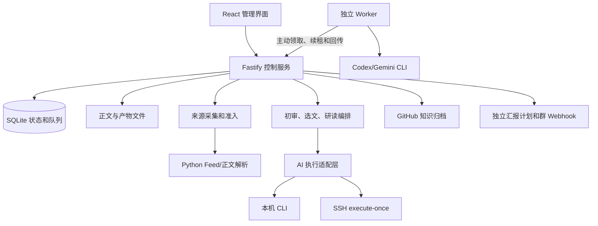

# OpenLore 项目理解与源码分析

## 状态与范围

- 日期：2026-10-23（Asia/Shanghai）。
- 仓库：`D:\Project\openlore`，`main`，快照 `926347d5f17943847d639b75c8f9349780efcd6e`。
- 目标：理解现有实现，判断它对“专业来源采集、每天群推送、Git 知识沉淀”的支持程度。本次未提出业务代码修改，也未进入方案设计。
- 方法：阅读产品与部署文档，并追踪入口、采集、初审、选文、研读、执行器、归档、汇报及关键测试。下面的“事实”来自当前代码，“判断”是基于调用链的解释。
- 验证限制：未安装依赖、启动服务、调用模型、访问真实业务数据、推送 GitHub 或发送群消息。测试仅阅读，没有执行；当前没有 `node_modules`。
- 上下文确认：待用户确认或纠正。

## 问题与项目定位

OpenLore 把技术信息处理成可追溯研报。它有独立的内容生产与交付流程，AI 负责初审、选文、研究和翻译，程序负责调度、身份、状态、结果接纳及对外交付。

**判断：最准确的定位是“由 AI CLI 执行研究任务的单实例知识生产工作台”。** 它已经有端到端业务实现，但没有完整的多用户租户隔离、高可用调度或跨系统恰好一次交付保证。

`openlore-notes` 是其中一个目标归档库，保存生成的 Markdown、图片和 manifest。源码库并没有把输出硬编码为该仓库；流水线通过仓库连接与 `base_path` 配置交付目的地。Wiki 阅读入口通过已配置的地址计算，不能据此认为本项目实现或部署了一个独立 Wiki 服务。

## 已核实事实与证据

下列路径均相对 OpenLore 仓库根；符号可直接定位实现。

| 编号 | 事实 | 主要证据 |
| --- | --- | --- |
| F01 | pnpm 管理 TypeScript monorepo；前端 React 19/Vite，后端 Fastify 5，SQLite/Drizzle，Python 解析 | 根、`apps/web`、`apps/server` 的 `package.json`；`workers/python/pyproject.toml` |
| F02 | 同一个 Node 控制进程提供 API、静态网页和调度；独立 worker 不启动网站 | `apps/server/src/cli/index.ts`：`serve`、`main`；`http/server.ts`：`createServer` |
| F03 | 文章采集有候选准入与补抓队列，先落候选再推进来源状态 | `modules/collection/service.ts`：`discover`、`enqueue`、`drain` |
| F04 | 初审按文章和正文版本共享；主题流水线不重新逐篇初审 | `modules/processing/article-reviews.ts`；`processing/service.ts`：`runProcessingForGroup` |
| F05 | GitHub 源码研读绕过文章初审；执行机准备源码并回传 commit | `processing/repository.ts`；`infrastructure/ai/repository_workspace.ts` |
| F06 | 支持 local、SSH、worker 三种 AI 执行传输 | `infrastructure/ai/executor_adapter.ts`：`execute` |
| F07 | Worker 任务持久化，有租约、续租、重领和过期结果拒收 | `modules/executors/queue.ts`：`claim`、`renew`、`complete` |
| F08 | 控制进程重启中断业务推进，不恢复内存中的业务协程 | `cli/index.ts:20` 起的启动清理；`scheduler/scheduler.ts`：`executePipeline` |
| F09 | GitHub 归档使用 Git Data API 创建 blob/tree/commit，再非强制更新分支 | `infrastructure/repositories/github/client.ts`：`syncFiles` |
| F10 | 群汇报是独立计划；模板渲染不调用 AI；按当天已归档成果汇总 | `modules/reports/service.ts`：`preview`、`send` |
| F11 | 管理访问共用管理令牌；Worker 使用配置级专用令牌 | `http/server.ts:35`；`modules/executors/service.ts` |
| F12 | Git 凭据和 Webhook 存本地 JSON，依靠系统权限保护，未做加密存储 | `infrastructure/secrets/local_file/secrets_store.ts` |

## 架构与职责

`apps/web/src/app/App.tsx` 与 `Layout.tsx` 提供每日研报、内容池、来源、流水线、汇报、运行记录和设置页面。前端通过 `/api/v1` 操作后端，业务不依赖页面常开。

`packages/contracts` 用 Zod 与 TypeScript 类型描述来源、处理结果、执行信封、归档和通知协议，同时包含 Prompt 和模板逻辑。因此它承担前后端共同契约，也承担部分共享业务规则。

Python 不是常驻采集服务：Node 下载材料，再通过标准输入输出 JSON 协议调用 Python。Python 用 feedparser 解析 Feed、trafilatura 提取正文；网络预算和业务状态由 Node 管理。

## 文章从来源到归档

1. **发现。** `AppScheduler.pollSources` 按来源轮询间隔触发；Feed 支持 ETag/Last-Modified 和待处理分页文件。采集与主题流水线相互独立，手动运行主题任务不表示先同步所有来源。
2. **候选准入。** `CollectionService.enqueue` 将每个发现项持久保存，再确认来源游标；准入依据发布日期、时间窗、分类、关键词和正文质量。旧内容、排除项、待补抓及人工复核状态不等于已入内容池。
3. **补抓。** 摘要或时间证据不足会进入 `pending`，通过网页正文适配器补全。单次采集使用请求预算，补抓循环有约 45 秒软预算；抓取失败最多三次，按次数分钟退避。单请求仍可能使整轮越过软预算。
4. **正文与身份。** 规范化 canonical URL 关联同一文章，`source_items` 保存多来源关系；正文 SHA-256 对应 `article_revisions` 与 blob 文件。完整正文不会被后续摘要降级覆盖。
5. **共享初审。** 正文新增或换版后排队，结果以 `(article_id, revision_hash)` 保存评分、定位、简介、标签和证据。初审使用默认/主执行器；不是每条主题流水线各评一次。正文不够会标记 `insufficient`。
6. **主题选文。** 流水线读取范围内所有已初审内容，未归档旧文章仍可竞争。模型主要看初审摘要，不逐篇发送全文；材料按 48,000 字符预算分批，必要时多轮缩选。返回 ID、唯一性和数量必须通过校验。`deep_analysis_count=0` 不调用选文或研究 AI。
7. **深度研究。** 对选中文章持有全局 claim，读取全文、准备图片与研究 Skill，再调用 AI。初审证据会做正文核对；研报本身的主要接纳条件仍是有可用正文和合法产物，并没有独立复核所有论断。
8. **交付。** 生成/复用中文译文、组合原文整理、研报、图片、条目入口、专题入口、批次与 manifest，再发送 GitHub。翻译属于归档路径中的额外 AI 开销，失败可阻止本批归档。
9. **确认。** 只有 GitHub 返回 `updated` 或 `unchanged`，才设置研报 `archived_at`。不能把 `research_tasks.status=succeeded` 单独视为已经发布。

**重要行为：** `completedResearchSql` 与 claim 以文章为单位，自动流水线会排除任何已经归档过的该文章，不限定当前主题，也不比较最新正文版本。这样可避免跨主题重复研究，但同一文章给多个主题产出不同分析、或原文更新后自动重研，都不能默认成立；显式手动研究另有允许已发布内容的入口。这是当前实现行为，不是缺陷定性。

## GitHub 仓库持续研读

`github_api` 与 `github_repository` 是不同能力：前者读取最近 10 条 Release；后者代表源码研究意图，不走普通采集轮询。

- 每个来源每轮可分配 `deep_analysis_count` 篇，轮换记录在 `repository_rotation`；优先继续未完成或未交付研究。
- 每次研究有独立 study/article 身份，canonical URL 附 study ID，避免把同仓库不同主题合并成同一篇文章。
- 控制服务发送来源、目标与历史研报；执行机解析真实默认分支，使用浅抓取的 bare cache，再建立独立 detached checkout，并记录 commit。
- 不获取 Git submodule 与 LFS 内容；历史代码不是完整深度历史。私有仓库取决于执行机自身读取凭据，不能仅凭控制端配置的输出仓库 Token 推导可读全部上游仓库。
- 同来源研究在当前进程内串行，后篇能看到前篇已接纳研报，包括本批尚未归档的成果；不同仓库可并行。
- 上传失败优先复用已有研报；明确重新研究则可重新解析源码版本。控制端还可从本地执行目录恢复已有文件，此恢复入口限制为 `local`，不能推广到远程机器任意找回产物。
- “结合历史避免重复选题”依赖历史材料与研究指令，不能解释为程序已证明所有主题语义不同。

主要依据：`processing/repository.ts`、`research/service.ts`、`repository_cache.ts`、`repository_workspace.ts`。

## AI 执行模型与成本

任务不是直接调用统一模型 HTTP API，而是经适配器调用用户已安装、已登录的 Codex/Gemini CLI。local 直接执行，SSH 请求远端 `execute-once`，worker 由执行机主动领取任务。

每个执行工作区包含输入、Prompt、所需 Skill 包和输出；源码研究另有 `input/repository`、`repository.json` 与历史上下文。Skill 有版本校验，会话修正有工作区与输入绑定。产物检查相对路径、符号链接、数量和体积；这些检查不等于对产物语义正确性的证明。

Worker 的典型时序：约 2 秒轮询，约 10 秒心跳和续租，租约 60 秒；续租持续失败超过约 40 秒则请求终止当前执行。服务端领取受 profile 并发限制，租约过期最多领取三次，过期 token 不能续租或提交。这里保证的是结果接纳身份；断网时旧进程与重领进程仍可能短暂重叠，不能承诺 AI 恰好执行一次。

`FallbackAIAdapter` 按首选/主执行器、其余配置顺序尝试，记录每次执行、失败原因、耗时与用量。对使用 `validateResult` 的任务，成功响应不符合校验时，可在有原会话的前提下做一次定点修正；不是所有任务、所有失败都会无限重试。

成本应拆成：新正文初审 + 主题批量选文 + 入选研读 + 文章归档翻译 + 失败/备用执行器尝试。每天群汇报由模板生成，不额外调用 AI。实际 token、延迟、模型质量与费用未测量。

## Git、manifest 与数据库的真实关系

`publishArchive` 先保存 `artifact_bundles`，再调用 GitHub，最后记录 `deliveries`。`syncFiles` 在一次新 tree/commit 中提交多个文件，使用 `force:false` 更新引用；远端分支竞争可导致失败，不会自动强推覆盖分支历史。

`loadManifest` 的来源是**控制端数据库里最近成功交付的 bundle**，不是每次读取远端 `.openlore/manifest.json`。`managed_files` 的哈希用于描述产物，不构成普通归档时对远端人工编辑逐文件比对的保护协议。因此：

- 人工改过的受管文件若被后续 bundle 再次写入，可能被生成内容覆盖；远端 ref 非强制更新不能解决这种内容层冲突。
- 只克隆 notes 不能恢复来源配置、原始材料、初审、运行、凭据、AI 队列和 bundle 历史；需备份控制端完整业务数据。
- GitHub 已提交而本地记账前崩溃，仍存在成功状态不确定窗口；Git 与 SQLite 不共享事务。
- `delivered_batches` 属于归档 manifest，不能作为群通知送达证明。

## 每日群汇报

`ReportService.preview` 按计划时区统计当日 `archived_at`，选取所关联任务的已发布研报，并生成模板内容。常规自动发送要求选中任务全部成功、没有在途运行且有可发送成果；`partial` 不满足正常发送条件。手动强制发送可以绕过就绪条件。

去重键包含计划 ID、日期、通知通道与排序后的流水线 ID。已记为 `sent` 则当天同组合不重复发送；模板或内容变化本身不会改变该键，追加推送需显式操作。

Webhook 适配飞书、Lark、i讯飞卡片，其余发送通用 JSON；同时检查 HTTP 状态与平台业务错误码。正常请求带 `Idempotency-Key`，但外部平台是否实际执行该键的去重未验证。消息已送到平台、响应丢失或本地尚未记账时，仍可能重复。

调度中用 `pending_date` 等待当天任务就绪。**返回 `failed` 后也会清掉 pending_date**，源码未显示跨后续分钟持续自动重试失败通知的完整机制；应区分“等待任务完成”与“发送失败重试”。

## 运行与可靠性边界

| 场景 | 已有行为 | 实际边界 |
| --- | --- | --- |
| Feed 已发现而补抓未完成 | 候选持久化，304 或来源失败仍可处理已发现候选 | 不代表每个历史来源条目均能回溯抓齐 |
| 同文章并行进入研究 | SQLite 事务 claim，持有到归档结束 | 自动研究排除是跨主题的 |
| 一篇研究失败 | 已开始的其他研究可收尾；有成功成果可归档，运行标记 partial | 尚未开始的条目可能不继续，正常汇报等待成功 |
| GitHub 交付失败 | 保留研报和输入，提供仅重试交付入口 | 翻译缓存缺失时仍可能有翻译调用；不能承诺完全无 AI |
| Worker 断网 | 租约失效、重领、拒收旧结果 | 可能重复计算，不保证旧进程即时退出 |
| 控制服务重启 | 在途研究/运行失败，queued/running AI jobs 取消，清 claims | 持久队列不等于完整工作流可恢复 |
| 停机错过流水线时间 | 每 30 秒匹配当前 cron，分钟去重在内存 | 未见持久 occurrence ledger 与漏跑补偿；重启也丢分钟去重 |
| 汇报成功但记账前退出 | 有本地已发送记录去重和请求幂等头 | 跨平台交付不具有总事务 |

工程判断：单控制实例、小团队、允许人工核查重跑的场景与当前设计较匹配。SQLite WAL、执行器并发和多 Worker 并不意味着可横向扩展多个控制节点；分钟去重、发送锁、研究串行与等待协程大量驻留进程内。

## 安全、配置与部署约束

- 控制端默认回环 `8767`；非回环监听要求管理令牌。HTTP 层是共享 Basic/Bearer 管理认证，未见完整成员账号、角色、文档 ACL 与租户隔离。
- Worker 专用令牌在服务端保存哈希；重新配对替换令牌并取消该 profile 在途任务。身份主要绑定 profile，尚非完整设备池模型；同 profile 心跳记录不能表达多台设备各自状态。
- 外部凭据以明文值保存于权限受限 `secrets.json`，Windows 的 `0600` 不应视作完整 ACL 或加密证明。
- 采集 HTTP 层有协议、私网与重定向检查，但私网判断未完整覆盖 IPv6 等地址，DNS 检查与实际 fetch 分开；大小限制发生在读完整个 `arrayBuffer` 之后。不能把 `SafeHttpClient` 名称视为已经完成 SSRF 与内存资源隔离验证。
- Codex 新任务配置 workspace-write、禁止审批，Gemini 使用 auto_edit 等参数；默认可继承用户配置。实际工具/网络权限还受 CLI 版本和用户配置影响，本次未做隔离实验。
- 文档主线：Node 24、pnpm 12、Python ≥3.12/uv；控制端需 Python，纯 Worker 不需要 Python。`service` CLI 是占位，未提供自动安装系统服务。
- 未实测 Windows 运行；部署文档主要是 macOS/Linux 命令，Git hooks 路径、子进程终止与 CLI 参数在本机兼容性须验证。

## 测试证据与可信度

已查看测试目录及代表性断言：

- `test/executor-reliability.test.ts:277`：错 profile/token 不可续租，进度脱敏，重领丢弃旧进度。
- `test/pipeline-report.test.ts:210`：重试交付不再次调用选文和研究，重复点击不并发启动同一次重试。
- `test/research-first.test.ts:294`：两个流水线不会同时占同一文章。
- 另检索了来源准入、归档失败、报告就绪、模板汇报、时区与源码工作区相关用例。

测试用临时数据目录隔离业务数据，多项使用 spy/mock 或模拟 CLI。上述说明仅代表测试代码有对应断言，**本次没有运行通过的测试结果**，也不代表真实模型、GitHub 与通知平台完成过联合验证。

## 对团队目标的适配判断

| 目标 | 当前判断 | 未核实部分 |
| --- | --- | --- |
| 精选技术来源 | RSS/Atom、网页有具体采集与准入实现 | 登录、反爬、动态网页的实际覆盖 |
| GitHub 项目深入学习 | 有默认分支快照、研究历史、连续主题、归档链路 | 私库权限、超大仓库、实际报告质量 |
| X、公众号自动持续采集 | 快照时无专用连接器；platform 仅抓 URL，截取前 5000 字符作为摘要。X 已在 `ykzhu14/access_x` 新增 `x_user` 来源，见 [X 接入](../x-integration/README.md) | 公众号未处理 |
| 每日群推送 | 独立定时计划、就绪等待、模板、平台适配与本地去重已实现 | 群机器人真实权限、平台去重语义和发送失败运维 |
| Git 长期沉淀 | 内容与源码分库、批次/索引/图片/研报版本化已实现 | 真实输出仓库权限、人工编辑协作规则 |
| 团队共同使用 | 可共享一个工作台和多个执行配置 | 成员身份、权限隔离、审计需求未满足或未验证 |

## 关键认识

1. 三种完成要分别看：AI 研究完成、Git 内容发布完成、群汇报发送完成。
2. 共用内容池和版本化初审减少重复输入；全局文章排除也限制自动跨主题重复研究。
3. 独立 Runner 的主要价值是把模型账号与计算留在执行机，控制端统一接纳成果和交付。
4. 恢复能力目前以“保存成果、拒收过期结果、人工选择重试”为主，不能按耐久工作流引擎理解。
5. 来源覆盖与团队权限是评估适用性时需要单独确认的能力，不能从产品定位推导。

以上为解释和关注方向，不构成候选方案、详细设计或改造承诺。

## 未验证假设与待确认项

| 编号 | 问题/假设 | 为什么影响后续判断 | 是否阻塞本次理解 |
| --- | --- | --- | --- |
| Q01 | 后续目的偏向部署使用，还是以它为基础改造？ | 决定后续调查范围 | 否 |
| Q02 | 团队是否必须原生接入 X/公众号，能否接受 RSS 中转？ | 决定来源能力是否足够 | 否 |
| Q03 | 使用飞书、Lark、i讯飞还是其他群平台？ | 决定真实交付验证对象 | 否 |
| Q04 | 团队需要每人独立账号和访问权限，还是可信成员共享管理？ | 决定现有共享管理模式是否合适 | 否 |
| Q05 | 谁提供常驻控制机和模型执行机，是否使用 Windows？ | 决定可用性与兼容性验证条件 | 否 |
| Q06 | 对停机漏跑、重复消息、失败后人工重跑的容忍度？ | 决定可靠性要求是否超过当前边界 | 否 |

## 确认记录

- 用户纠正：待补充。
- 确认人/时间：待确认。
