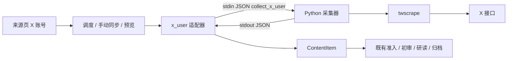

# X 接入实现设计

状态：已实现，2026-10-26。

## 代码位置

| 层 | 文件 |
| --- | --- |
| 契约 | `packages/contracts/src/x-source.ts`、`python_protocol.ts`、`entities.ts` |
| Python | `workers/python/src/openlore_collectors/x_user/{collector,accounts}.py`、`__main__.py`、`protocol.py` |
| Node | `apps/server/src/modules/collection/collectors/x_user/adapter.ts`、`collection/{service,quality}.ts`、`scheduler/scheduler.ts`、`sources/service.ts`、`infrastructure/python/runner.ts` |
| Web | `apps/web/src/features/sources/SourcesPage.tsx` |
| 测试 | `apps/server/test/x-source.test.ts`、`workers/python/tests/test_x_user.py` |

## 来源配置

- `capability_id = x_user`，URL 只接受 X/Twitter 账号主页，保存时规范为 `https://x.com/<handle>`；保留路径（`search`、`i` 等）、带端口或 userinfo 的地址拒绝。采集器不接收任意请求目标。
- 复用现有来源选项（时间窗、当年、关键词、轮询间隔）。界面不显示“用原文核验首发日期”，日期由下文的 ID 核验替代。

## 会话

- 会话库：`$OPENLORE_DATA_DIR/x/accounts.db`（twscrape 自有 SQLite），只在控制端读取，不发给 AI 执行机。
- 用 `python -m openlore_collectors.x_user.accounts add|list|remove` 管理；Cookie（需 `auth_token`、`ct0`）从 stdin 或隐藏输入读取，不经命令行参数。POSIX 下目录 0700、文件 0600；Windows 依赖用户目录 ACL。
- 会话库只存认证和限流信息；候选、游标、冷却等业务状态都存 OpenLore SQLite。

## Python 协议

请求按 `operation` 区分：`parse_feed`/`extract_article` 读本地文件；`collect_x_user` 使用独立请求结构，字段为 `handle`、`accounts_db`、`state`、`budget{max_pages, deadline_seconds}`。Node 用 `XCollectDataSchema` 校验返回，不合规时判为 `invalid_worker_output`。

子进程环境只继承系统、语言、证书、代理变量（含 `TWS_PROXY`），并设置 `TWS_TELEMETRY=0`。stderr 只保留末尾 8 KiB，写入错误信息前截短并屏蔽类凭据字段。Windows 下优先使用 `.venv/Scripts/python.exe`，找不到时回退到 `python`。

## 采集与增量

适配器内串行执行，避免 twscrape 的占用锁被误报为限流。每次调用：1 次 `user_by_login` 加上最多 `ceil(limit/40)` 页时间线（正式同步 3 页、预览 1 页，上限 5），软截止 50 秒，父进程 70 秒后强杀。

状态 `XUserState`：`user_id`、`newest_id`（完成水位）、`pending{cursor, top_id, stop_id}`（续扫）。

- 只有扫到 `stop_id`（上次水位）或时间线到底才算完成（`scan=complete`），这时把水位推进到本轮最大 ID。
- 页数预算用完但没扫完（`scan=more`）：保存 `pending`，水位不动，下次从 cursor 续扫。调度器把 `pending.cursor` 当作待续工作。
- 首次扫描（无水位）只取预算内的页，不回填更早的历史（`scan=limited`）。
- 置顶帖不参与水位计算；`id <= stop_id` 的旧帖在采集端直接过滤。
- 账号 ID 变了（同名账号已换人）时清空状态，并上报 `x_user_changed`。
- 部分页成功后出错或超时：返回 `partial`，带已取结果和对应状态，由服务端照常落库。
- 首页为空判为失败（`x_empty_timeline`，twscrape 被拦截时也是空页）；续扫为空视为结束，上报 `x_continuation_empty`。
- 预览不传状态，也不保存 `next_state`。

收录范围：只保留该账号本人的帖子；转帖、对他人的回复、响应中夹带的他人帖子都会过滤掉。

## 错误与冷却

| code | 含义 | 可重试 |
| --- | --- | --- |
| `x_no_account` | 未导入会话 | 否 |
| `x_auth_invalid` | 会话全部失效 | 否 |
| `x_rate_limited` | 限流或占用，带 `retry_after_seconds`（≥60，取会话库的解锁时间） | 是 |
| `x_user_unavailable` / `x_empty_timeline` | 账号不可读或被拦截 | 是 |
| `x_timeout` / `x_collect_error` / `x_api_changed` / `x_dependency_missing` | 其他 | 视情况 |

正式同步和预览返回的失败结果只要带 `retry_after_seconds`，就在 `source_states` 写入 `cooldown_until`。写入用 `json_set`，只改这一个字段，不覆盖、也不推进扫描水位。冷却期内调度（含强制）、手动同步、预览都直接返回 `cooldown`，不启动子进程。冷却过期后，发给采集器的状态里会去掉这个标记。

## 帖子到 ContentItem

- `source_item_id = <source_id>:x:<post_id>`；`canonical_url = https://x.com/i/status/<id>`。`normalizeUrl` 把 x.com/twitter.com 下所有 status 地址都归一到这个格式，所以多个来源收到同一帖只建一篇文章。
- 正文：帖文（t.co 已展开，媒体和引用的 t.co 去掉）+ 引用块（`引用 @作者（链接）：`）+ 链接列表 + 媒体计数（标注“未转写”）。标题取 `@handle：` 加正文前 60 字。
- 日期：`published_at` 取接口返回的 `created_at`；与帖子 ID 内嵌时间相差不到 5 分钟记 `verified`，超出记 `conflict`。
- `fetch_method = x_user`；`issues` 标记 `x_quote`、`x_self_reply`、`x_pinned`、`x_media_only`。

## 准入差异（仅 `x_user`）

| 规则 | 普通文章 | X 帖子 |
| --- | --- | --- |
| 日期未核验或冲突 | 进入补抓 | 待复核，不回抓 X 网页 |
| 正文不完整 | 进入补抓 | 待复核（`body_invalid`） |
| 最短正文 | 80 字 | 去掉链接后 40 字 |
| 已终态候选再次出现、正文为空 | 重新补抓 | 不补抓 |

其余规则（关键词、分类、时间窗、ready 判重、初审 16 字证据要求）不变。

## 已知限制

- 线程不合并，自串回复各自成条；单条回复不代表完整上下文。
- 已收录的帖子不跟踪编辑或删除；已归档的帖子不会自动重研。
- 首次扫描不回填历史；长时间停机超过时间线窗口可能漏帖。twscrape 声称时间线上限约 3200 条，未实测。
- twscrape 解析失败时会把原始响应写到 `/tmp/twscrape`，Windows 下的落盘位置和清理未处理。

## 回滚

先停用 X 来源，再回退代码。会话库和已入池的文章保留；普通 RSS 来源不受影响。
