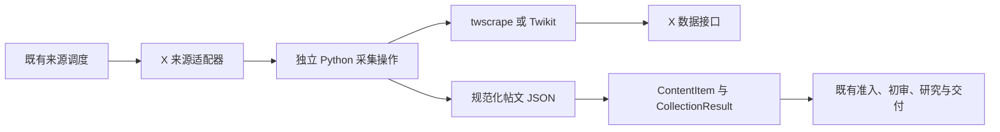

# OpenLore 接入 X：需求、路线评估与 Agent 交接

更新时间：2026-10-24（Asia/Shanghai）。本文件是本需求的汇总入口，可独立阅读。**项目源码事实、外部项目能力、建议方案和验证结果分别标注；设计稿不表示功能已实现。**

## 1. 先读结论

用户希望在自己的 OpenLore Fork 中接入 X 技术信息来源，本地验证后向原项目提 PR。先前倾向复用“X → RSS 中间服务 → OpenLore”，现在明确要求评估开源 Python 采集路线，并汇总所有信息供其他 Agent 接手。

**结论：开源 Python 采集可行，值得与 RSSHub 做同条件的小规模取数验证。现有 Python worker 并非现成的 X 服务，只提供文件解析。** 若直接采集胜出，建议新增一个 X 来源适配器，通过独立 Python 采集操作获取结构化帖文，再接入现有内容池；没有必要为了复用业务链路而先转 RSS、再解析回 JSON。

两条路线共享 X 帖子的规范化、准入、初审、研究与交付逻辑。RSSHub 把登录和取数维护放到中间服务；Python 直连省去 RSS 服务，却把账号会话、限流与增量管理带进 OpenLore。尚无真实采集证据支持最终选型。

## 2. 用户已确定的目标与工作方式

- 在个人 Fork 开发、测试，之后向 `decent-yu/openlore` 提 PR。
- 沿用 `D:\Project\openlore`，只用独立分支；**用户明确不需要独立工作树**。
- 原先提出过 `ykzhu14/接入x`，现在实际分支为 `ykzhu14/access_x`，后续沿用当前名称。
- 当前请求是评估与文档汇总，尚未明确要求开始业务代码实现、部署采集器或真实对外交付。
- 指定账号、凭据方式、部署位置、帖子/线程/外链处理细节尚未最终确定。

建议首版以 2～3 个公开技术账号的独立帖文为对象，保留原帖身份、作者、时间、正文、引用及链接。自动拼接完整线程、视频/OCR、全网搜索、删除同步、已归档帖子自动重研先不纳入首版。这些是范围建议，不是用户已批准的全部验收要求。

## 3. 仓库与环境快照

| 项目 | 2026-10-24 核查结果 |
| --- | --- |
| 业务源码目录 | `D:\Project\openlore` |
| 当前分支 | `ykzhu14/access_x` |
| origin | `git@github.com:kkcaideyi/openlore.git` |
| upstream | `git@github.com:decent-yu/openlore.git` |
| HEAD | `f637c708d059285dc14475541b92e0cfc5299fb1` |
| 远端跟踪 | 本地 `origin/ykzhu14/access_x` 与 HEAD 一致；本轮未 fetch 核实远端新变化 |
| 业务源码分析基线 | `926347d5f17943847d639b75c8f9349780efcd6e`，后续两个提交只增加/调整设计文档 |
| 工作树 | 仅 `D:/Project/openlore` 一处；先前 `openlore-x` 已移除 |
| 未提交内容 | X 需求记录修改，以及此前生成的上下文、比较、设计、测试计划和本汇总；保留这些内容 |
| 环境安装 | 本地未见 `node_modules` 或 `workers/python/.venv`；其他工具安装情况未完整核查 |

本聊天最初的 cwd 是 `D:\Project\openlore-notes`，调用命令必须显式设置源码工作目录。`openlore-notes` 只保存生成的 Markdown、图片、manifest；它不是本需求的开发目录，也不能替代控制端数据库备份。

仓库 `AGENTS.md` 要求表达简洁；没有要求本任务新建工作树。不要把此汇总当作修改用户分支或推送 PR 的新授权；以用户后续指令为准。

## 4. OpenLore 的最小架构背景

React/Vite 管理界面 → Fastify Node 控制服务 → SQLite/正文 blob。控制服务负责来源、调度、候选准入、内容池、AI 编排、GitHub 归档与群汇报。

文章链路：来源发现 → 候选持久化/正文补抓 → 准入入池 → 版本化共享初审 → 按主题选文 → 研读 → 翻译/归档 → 独立计划群汇报。

GitHub 仓库研读另走源码研究流程，由 AI 执行机准备默认分支快照。其与 X 内容采集不是同一个连接器。

| 名称容易混淆的组件 | 实际职责 |
| --- | --- |
| `workers/python` | 控制服务本机启动的 Python 子进程，读取已下载文件并解析 Feed/网页 |
| AI Runner / `openlore worker` | Node 进程，在执行机主动领取 AI 任务，调用 Codex/Gemini CLI |
| RSSHub | 可另行部署的 X→RSS 中间服务；目前未部署或接入 |

不要把 X 登录会话发给 AI Runner。RSSHub 路线会话留在 RSSHub；Python 直连路线会话放在实际运行采集器的控制端/受控执行环境。

可靠性边界：控制服务按单实例设计；重启会将运行中的业务标失败并取消在途 AI jobs。AI 研究成功、Git 归档成功和群通知成功分别记账。本需求不顺带改造这些通用机制。

## 5. 对“Python worker 接了一个开源服务”的核查

**事实：它是 OpenLore 自己的封装，复用开源库，不是开箱即用的采集服务。**

- `workers/python/pyproject.toml`：Python ≥3.12，依赖 `feedparser`、`trafilatura`、`jsonschema`。
- `feedparser` 解析已有 RSS/Atom，`trafilatura` 提取已有 HTML 正文；它们不提供 X 登录和动态列表获取。
- `packages/contracts/src/python_protocol.ts`：operation 仅 `parse_feed` / `extract_article`，必填 `input_path`。
- Python `__main__.py` 先验证本地 input_path，再读取文件；Node 负责下载后通过 stdin/stdout JSON 协议调用。
- `infrastructure/python/runner.ts`：每次 spawn `python -m openlore_collectors`，默认 30 秒超时，stdout 必须是一个 JSON，超过 16 MiB 会终止。
- Windows 路径目前仅查 `.venv/bin/python`，否则用 `python3`；没有显式查 `.venv/Scripts/python.exe`。接入前应做本机启动验证。

**推论：**可以复用 Python 部署环境、进程管理与 JSON 协议思想，但不能只增加一个依赖就得到稳定的 X 订阅。网络采集需要新的输入、状态与错误语义。也不宜通过伪造 input_path 把“采集账号动态”塞进“解析文件”操作。

## 6. 候选工具与路线比较

官方入口： [RSSHub](https://github.com/DIYgod/RSSHub)、[twscrape](https://github.com/vladkens/twscrape)、[Twikit](https://github.com/d60/twikit)、[Nitter](https://github.com/zedeus/nitter)。RSSHub/Nitter 为在线分支材料；本轮 Python 库的固定 commit 与证据见第 13 节，实施时按选定版本复核。

| 路线 | 能复用什么 | 需要额外承担什么 | 初步建议 |
| --- | --- | --- | --- |
| RSSHub → 现有 RSS 适配器 | Feed 抓取、解析、分页缓存及后续业务 | RSSHub 部署与会话、Feed 完整性约定；本机端点可能需受限访问配置 | 保留为首选候选，先测取数 |
| twscrape → Python 操作 → X 适配器 | Python 环境、Collector 接口、内容池及后续业务 | 账号库、网络预算、游标、限流状态、协议和新来源类型 | 直连优先验证候选 |
| Twikit → Python 操作 → X 适配器 | 同上；可细致使用用户/帖子 API | 会话、限流、调度与状态封装 | 对照候选，不同时实现两套生产适配 |
| 自写 Python → RSS 服务 → OpenLore | OpenLore 的 RSS 消费端 | 同时维护 Python 采集器和 RSS 输出/缓存/HTTP 服务 | 有其他 RSS 消费方时更有价值；只服务 OpenLore 不优先 |
| 原生官方 X API | 通用 Collector 及业务流程 | 官方权限/费用、分页和适配 | 团队已有权限时复评，本次未核实价格 |

### RSSHub 已确认到什么程度

2026-10-24 已读 [user.ts](https://github.com/DIYgod/RSSHub/blob/master/lib/routes/twitter/user.ts)、[namespace.ts](https://github.com/DIYgod/RSSHub/blob/master/lib/routes/twitter/namespace.ts)、[api/index.ts](https://github.com/DIYgod/RSSHub/blob/master/lib/routes/twitter/api/index.ts)：存在 `/twitter/user/:id/:routeParams?`；可选择 Web 登录 `auth_token` Cookie 或开发者 API 路径，未配置会报错。旧移动端用户名密码方式已标为不可用。回复/转帖有路由过滤；不存在本次已验证可直接使用的匿名公共 Feed。

### 开源 Python 工具已确认到什么程度

先前读取的 README：twscrape 提供异步 API/CLI、账号会话库和限流管理；Twikit 提供用户帖文、搜索、登录/Cookie。**不需要官方 API Key 不等于无需账号会话，也不等于无成本、永久可用。** 本轮外部源码核查细节见第 13 节。

Nitter README 说明 RSS 依实例配置，部分关闭，且存在项目持续运营不确定性；暂不列为优先验证对象。

## 7. 直接 Python 采集的建议结构

### 边界与修改点

建议新建 `x_user` capability，面向指定账号；复用已有 `CollectorAdapter.collect(request)` 返回 `CollectionResult`。不要把目前功能很弱的 `platform` 直接冒充 X 集成。

| 层次 | 计划修改位置/职责 |
| --- | --- |
| 来源配置 | `entities.ts`、sources service、SourcesPage：账号、轮询、时间窗、过滤及采集凭据引用 |
| Node 适配 | 新 X adapter + registry 注册，将 profile URL/账号解析为受约束目标，不接受任意请求 URL |
| Python 采集 | 独立模块/操作，例如 `collect_x_user`；与现有文件解析请求形成可校验的联合协议，或专用采集 envelope |
| 依赖部署 | 固定库版本；优先可选依赖/专用采集环境，避免普通 RSS 用户被迫安装 X 采集所需全部依赖 |
| 结果校验 | Node 对 Python 返回值执行运行时 Schema 校验，拒绝不符协议/类型/体积的结果 |
| 状态与限流 | OpenLore 管来源游标/候选，采集库管账号会话；同账号共享容量与 next_attempt_at |
| 共同内容层 | X 帖子 ID、正文、日期、内容类型、准入及初审适配，RSS 路线也需要 |
| Windows | Python venv 定位、子进程超时与取消验证 |

现在 CollectionRequest 虽含可选 `credential_ref`，CollectionService.request 并未贯通来源凭据，SourceOptions 也没有完整账号选择。不能因契约里出现字段就假定凭据管理已完成。

### 会话、超时与限流

- 用用户合法授权的会话，验证前由用户在本地配置。不要让 Agent 搜索浏览器凭据或把 Cookie 发进对话、模型输入、Git 或日志。
- 可把采集库的会话文件/SQLite 存入业务数据目录专用子目录，来源只保存配置 ID；不要把账号文件跟随每次任务目录清理。Windows 要明确 ACL，不能仅靠 POSIX 0600 声称已保护。
- stdout 仅写 JSON，日志走脱敏且限长 stderr；现有 runner 会把 stderr/部分原始输出放进错误信息，不能直接用于可能含凭据的爬虫输出。
- 现有预算 20 秒/10 次请求、Python 默认 30 秒并不自动约束 SDK 内部重试/分页。首版 POC 可设一账号一次采集 60 秒、最多 2 页作为试验预算，随后按实测调整；父进程截止时间覆盖所有内部等待。页数应在可观测的请求/分页边界计数，不能把 SDK 的 limit 条数误当实际网络请求上限。
- 无可用会话、认证失效、限流、网络超时分别返回错误。无账号直接退出，不在子进程中等待账号恢复；限流交回调度器按 reset/retry_after 再试。现有 Scheduler 没有消费 CollectionError.retry_after_seconds，既有“最多三次重试”属于网页补抓，直连需要显式补上冷却接线。
- 当前来源轮询按 source 串行，长时间挂起会拖慢后续来源。Source 级 active 不能代替账号级互斥；首版同一会话串行，多个来源共享冷却状态。专用子进程只传必要环境变量；现有 runner 继承完整 process.env，不直接套用到认证采集。
- 不靠增加账号规避平台限制。采集库的账号池能力不是本需求多账号轮换的默认要求。

**必须补的调度接线：**现在 CollectionService 只在结果非 failed 时保存 next_state，429/认证失败若仅把冷却时间放 next_state 会丢失。需将源/凭据的调度状态与扫描水位分开持久化：失败可保存冷却/认证失效，但不推进采集水位。Scheduler 当前只识别 RSS 的 pending_items_ref，新 X cursor 和待续页需显式接线；凭据冷却优先于 pending/force/预览，不能通过手动操作绕过。

### 增量与不丢候选

建议状态包含 stable_user_id、上次完成水位、待续页 cursor、当前扫描边界、next_attempt_at。库能翻页不表示 OpenLore 已拥有持久增量状态。

一次发现所有返回帖文先落候选，再推进来源状态；本次只有完整扫描结束才提交“完成水位”。预算到期保留续页信息或使用有界重叠扫描，不把已取到的最新 ID 直接当作全批完成。

当前子进程只在结束时回一个 JSON；若父进程直接杀掉它，已取到但未回传的页不会自动成为 checkpoint。设计采集器软截止早于父进程硬超时，留数秒返回 partial/items/续页状态；硬终止时仍用旧持久游标重叠重试。首版不必因此引入流式协议。

不能仅凭一条旧帖就停止：时间线可能有置顶、转帖或非严格时间序。游标失效时重叠读取并以帖子 ID 去重。网络中途失败要返回已获取页及对应 partial 状态，不标作成功空结果。预览只试读，不消费正式来源游标。

账号会话数据库只存库自身认证/限流信息，业务候选、归档与调度事实仍由 OpenLore SQLite 保存；不要让两个数据库共同竞争同一业务状态的权威性。

## 8. 两条路线都绕不开的内容适配

1. **稳定身份。** 用原始 post_id 去重，source_item_id 可为 `source_id:x:post_id`；统一 X/Twitter status URL 别名，保留原帖 URL、作者、引用关系。
2. **日期。** 存原帖 created_at，标记证据来自 Feed/采集接口；不要用抓取时间替代，不伪造回源 verified=true。
3. **短正文。** 现有 80 字符准入、标题重复判断、初审最少 16 字符引文必须分别处理。实质短帖可入池；不足初审证据的条目保留为 insufficient，不用作者/时间等元数据凑证据。
4. **不回抓 X HTML。** x_post 截断、日期或上下文不足时待复核，不能像普通摘要那样自动转 web_page 补抓三次。
5. **上下文归属。** 引用别人内容必须保留引用作者；单条回复不等于完整线程。库有回复/对话 API 不等于线程已自动合并。
6. **长帖与媒体。** 验证 long-form/note_tweet 是否解析完整；只有图片/视频不应冒充完整文本。首版保留链接，不做 OCR/转写。
7. **元数据持久化。** 计划为正文版本保存 content_context（类型/帖文身份/正文来源/日期来源）；新增字段与迁移均未实现。
8. **已收录变化。** 现有 ready 候选立即判重，已归档研究也会被自动排除；首版可沿用“新帖优先”，但必须说明编辑/删除及自动重研未覆盖。

因此，“直接调用 Python 拿到 JSON”只解决上游取数；内容适配不会因为省掉 RSS 而消失。

## 9. 当前建议与实施顺序

**修订先前判断：Python 直连应列为正式候选，不能仅因它需要新适配器就判断比 RSSHub 明显更复杂。** 如果用户没有可用 RSSHub 部署、只需服务 OpenLore，直连可省一个常驻服务以及私网 Feed 例外配置；如果团队已有可靠 RSSHub 或需多个 RSS 消费方，RSS 路线维护成本更低。

先选同一组账号，分别验证 RSSHub 与 twscrape（Twikit 只在有明显差异时补测）。对照记录：真实取数率、正文完整性、身份/时间字段、认证维护、限流表现、部署成本。不要同时实现两套生产连接器。

| 阶段 | 交付 | 退出条件 |
| --- | --- | --- |
| P0 可行性验证 | 固定版本、2～3 个账号脱敏样本与对照记录 | 至少验证新帖出现、重复读取、失败可识别；无法取得会话时明确受阻 |
| P1 确定路线 | 一条生产主线与共同 ContentItem 契约 | 用户确认部署/凭据条件，按证据选 RSS 或直连 |
| P2 实现 | 来源配置、适配器/策略、幂等、元数据和初审衔接 | 离线集成测试与普通 RSS 回归通过 |
| P3 真实试运行 | 独立数据目录，有限账号/研究预算，测试归档与通知 | 下节验收标准通过 |
| P4 整理 PR | 有界改动、固定依赖、运行文档及已知限制 | 明确目标上游与范围后提交 |

粗估：开源库取数 POC 0.5～1 人日；直连生产适配及共享内容改造 3～5 人日；回归/文档 1～2 人日。RSS 方案此前估算 3.5～6 人日，内网/Windows 增补另预留 1～2 人日。这些不是工期承诺，不包含凭据等待、反爬变化或评审；同类共同改造不要重复累计。

## 10. 验证与验收摘要

- **离线样本**：正常/短/长帖、引用、线程片段、转帖、只有外链、缺日期、未来时间、重复 GUID、X/Twitter URL 别名、截断正文。
- **幂等**：同一帖连续拉取 10 次只新增一个文章/初审，多个来源关系保留；预览不推进正式游标。
- **恢复**：分页超时、候选写入中断、游标过期后重试不丢已发现页；SDK 无账号/限流返回及时，不阻塞全部来源。
- **凭据边界**：凭据仅用于实际采集端；错误、stdout/stderr、fixture、归档和 AI 输入无 Cookie/token。直连限定账号目标，RSS 内网例外只作用于指定 Feed 端点。
- **回归**：Python 测试、contracts/server/web 类型检查、collection-quality、pool-admission、source-ingestion、assessment-evidence、research-first、pipeline-report 等关联测试；代码未改时不声称运行过。
- **真实观察**：建议 3 来源/30 分钟轮询/48 小时，取数成功率目标 ≥95%，至少出现一条可独立核对的新帖。统计实际返回集合，不把有限时间线窗口等同完整历史覆盖。
- **端到端**：至少一条有价值的帖文完成初审、选文、研究和测试仓库归档，使用明确的测试群验证链接；失败状态可查。
- **回滚**：先停 X 来源再回退功能，保留正文元数据和文章；普通 RSS 继续运行。

真实试运行需要账号会话及明确测试 AI/仓库/群目标，不属于本轮已执行的动作。

## 11. 主要源码阅读地图

路径相对 `D:\Project\openlore`：

| 文件 | 需要关注 |
| --- | --- |
| `packages/contracts/src/entities.ts`、`collection.ts`、`python_protocol.ts` | 来源类型、选项、ContentItem、预算、Python 协议 |
| `apps/server/src/modules/collection/service.ts` | 适配器注册、candidate 落盘、游标确认、ready 判重、补抓 |
| `apps/server/src/modules/collection/quality.ts` | URL 规范化、日期证据、80 字符/关键词规则 |
| `apps/server/src/modules/collection/collectors/web_feed/adapter.ts` | RSS 日期未验证、ID、ETag/分页缓存 |
| `workers/python/src/openlore_collectors/{__main__,protocol}.py` | 本地文件解析入口及请求结构 |
| `workers/python/src/openlore_collectors/web_feed/parser.py` | content/description 选择与长度完整度启发式 |
| `apps/server/src/infrastructure/python/runner.ts` | Windows Python 路径、超时、输出限制、日志泄漏边界 |
| `apps/server/src/modules/processing/article-reviews.ts`、`assessment.ts` | 初审队列、正文引用核验、材料不足 |
| `apps/server/src/modules/scheduler/scheduler.ts` | 来源串行轮询、pending/continuation 判断 |
| `apps/server/src/infrastructure/persistence/sqlite/{db,schema}.ts` | source_states/candidates/revisions；新增 schema 必须两处同步 |
| `apps/server/src/infrastructure/http/client.ts` | RSS 中间服务私网限制；不覆盖 Python SDK 自己的网络请求 |
| `apps/web/src/features/sources/SourcesPage.tsx` | 新来源/模式、预览、采集状态 |

## 12. 交接时的完成状态与下一步

**已完成**：源码阅读、Fork 远程配置核查、需求分支和文档准备、RSSHub 路由源码确认、开源库路线评估。两份原始文档已有提交，后续方案与本文件尚为工作区文档。

**尚未完成**：最终选型、采集依赖安装、RSSHub 部署、真实 X 登录/抓取、代码实现、测试运行、真实 AI/归档/群消息验证、PR。不要将文档、SDK 函数存在或模拟测试误写为接入成功。

后续 Agent 从这里开始：

1. 显式使用 `D:\Project\openlore`，检查 status/branch/remotes；保留已有文档修改，不重建工作树、不擅自切分支。
2. 取得用户希望观察的账号、可用部署方式和会话/API 条件，再执行获授权的 P0；无需重新研究整个项目。
3. 固定候选版本，先拿到真实样本，记录登录、限流、完整性和新增帖证据。
4. 选定路线后更新相应设计，再按用户实施指令改代码。未经真实验证仍应清晰标注外部依赖不确定性。

历史资料保留： [需求记录](01-requirements-and-status.md)、[上下文](01-context-brief.md)、[旧方案比较](02-options.md)、[RSS 专项设计](03-design.md)、[RSS 测试计划](04-test-plan.md)、[总体源码分析](../openlore-understanding/01-context-brief.md)。本汇总的路线判断更新了旧文档“Python 直连首版不优先”的笼统结论；RSS 专项细节仅在选定 RSS 后适用。

## 13. 本轮开源工具源码核查补充

核查日期 2026-10-24。只阅读公开文档/源码，未安装或运行采集器、未访问用户凭据。推荐 twscrape 为直连 POC 首选，原因是它已封装采集型账号状态、分页和限流管理；Twikit 为备选。这是结构与集成成本判断，不是可靠性实测排名。

| 核查项 | twscrape | Twikit |
| --- | --- | --- |
| 固定源码快照 | `63f61a518e576ea5c132f1156c03dda0520d76c1` | `c3b7220866f8582009fe2d1155b6fe92192a2711` |
| 包声明 | Python ≥3.10，源码版本 0.20.1 | setup.py 声明 Python ≥3.8；实际兼容性未验证 |
| 许可证 | MIT | MIT |
| 鉴权 | 已授权账号，推荐 auth_token + ct0 Cookie | 登录并保存/加载 Cookie，README 明确无需官方 API Key |
| 采集接口 | user_by_login、user_tweets、user_tweets_and_replies、搜索 | get_user_tweets(user_id, tweet_type, count, cursor) |
| 分页 | 内部 cursor 异步生成器；会话存 SQLite | Result.next_cursor/previous_cursor 及续取回调 |
| 长帖 | rawContent 优先读取 note_tweet 正文 | 应使用 full_text；text 是 legacy full_text，可能漏长帖部分 |
| 限流 | 账号和端点锁；默认可能一直等可用账号 | TooManyRequests 等异常，需上层调度 |
| RSS/持久订阅水位 | 均未替 OpenLore 提供 | 均未替 OpenLore 提供 |

必须保留的实现边界：

1. twscrape `tweet_thread()` 对 TweetDetail 分页结果按 `conversationId == 传入ID` 过滤；需要使用会话根 ID，结果不保证只有作者自串，也不证明完整。Twikit `.thread` 来自响应的 SelfThread 展示模块，同样不是完整线程重建器。
2. twscrape 后续页失败可在先前已 yield 部分结果后抛错。调用方必须保存 partial 结果及未完成边界，不能吞异常后记 complete。
3. twscrape 集成需明确有限 `wait_timeout`、`raise_when_no_account` 行为及任务级截止时间；默认等待方式不适合无监督来源轮询。
4. twscrape README 提到用户时间线约 3200 帖边界，这是项目声明，不作为本项目已实测覆盖承诺。仅限条数的接口不是历史完整性保证。
5. MIT 是库代码许可；不证明数据接口授权、账号状态、网络或采集可用性。实际使用仍依赖团队有权使用的会话及服务条件。

固定证据入口：

- twscrape：[README](https://github.com/vladkens/twscrape/blob/63f61a518e576ea5c132f1156c03dda0520d76c1/readme.md)、[api.py](https://github.com/vladkens/twscrape/blob/63f61a518e576ea5c132f1156c03dda0520d76c1/twscrape/api.py)、[models.py](https://github.com/vladkens/twscrape/blob/63f61a518e576ea5c132f1156c03dda0520d76c1/twscrape/models.py)、[包配置](https://github.com/vladkens/twscrape/blob/63f61a518e576ea5c132f1156c03dda0520d76c1/pyproject.toml)、[LICENSE](https://github.com/vladkens/twscrape/blob/63f61a518e576ea5c132f1156c03dda0520d76c1/LICENSE)。
- Twikit：[README](https://github.com/d60/twikit/blob/c3b7220866f8582009fe2d1155b6fe92192a2711/README.md)、[client.py](https://github.com/d60/twikit/blob/c3b7220866f8582009fe2d1155b6fe92192a2711/twikit/client/client.py)、[tweet.py](https://github.com/d60/twikit/blob/c3b7220866f8582009fe2d1155b6fe92192a2711/twikit/tweet.py)、[setup.py](https://github.com/d60/twikit/blob/c3b7220866f8582009fe2d1155b6fe92192a2711/setup.py)、[LICENSE](https://github.com/d60/twikit/blob/c3b7220866f8582009fe2d1155b6fe92192a2711/LICENSE)。

## 14. 实施状态（2026-10-25）

**选型：twscrape 直连（`x_user` 来源）。** 理由：省去常驻 RSSHub；结构化字段（帖子 ID、作者、引用、长帖 note_tweet、外链）无需从 RSS 再解析；两条路线都需要同样的 X 会话。RSSHub 路线未实现。

已实现（未提交）：

| 层 | 内容 |
| --- | --- |
| contracts | `x_user` capability；`parseXProfile`/`xStatusId`；Python 协议改为按 operation 区分的联合类型；`XCollectDataSchema` 供 Node 运行时校验 |
| Python | `collect_x_user`：置顶帖不参与水位；完整扫描才推进 `newest_id`，预算不足保存 `pending` 游标续扫；首扫不回填历史；软截止返回 partial；空时间线/用户不可读判为失败；会话错误按账号库区分 `x_no_account`/`x_auth_invalid`/`x_rate_limited(retry_after)`；`accounts` CLI 导入 Cookie |
| Node | `x_user` 适配器（串行、70 秒硬超时）；帖子→ContentItem（规范 URL `x.com/i/status/<id>`、Snowflake 交叉核验日期、引用署名）；准入：帖子不进入网页补抓，去链接后 ≥40 字；失败时冷却与未推进的游标分开保存，调度/手动/预览均受冷却约束；runner 修复 Windows venv 路径、子进程最小环境变量、诊断脱敏 |
| Web | 来源页新增“X 账号”类型 |

验证：Python 17 项通过；server 新增 `x-source.test.ts` 10 项通过（含真实拉起 worker），全量 246 过/25 败，25 项为改动前即失败的 Windows 执行器用例；三包 typecheck、web build/test 通过；HTTP 冒烟（独立数据目录）通过。本机 Node 24 无 better-sqlite3 预编译包，测试用便携 Node 22 运行。

**真实取数（P0，2026-10-25）通过**（详见 [05-test-report.md](05-test-report.md)）：用户会话，经公司代理；@simonw/@karpathy/@swyx 首扫各 2–4 次请求、4–5 秒；133 条候选发布时间全部与 Snowflake 一致；外链展开、引用署名正常；入池 78、待复核 4（短帖/仅链接）、窗口外 50、2020 年置顶帖被排除；增量同步 0 条、`scan=complete`。发现并修复：增量时水位以下旧帖仍被返回（仅判重拦下），现于采集端过滤。

**未验证**：48 小时试运行、限流冷却的真实触发、端到端研究/归档。

已知限制：线程不合并（自串回复各自成条）；编辑/删除不同步；twscrape 被拦截时可能表现为空页（首页为空判失败，续扫为空则视为结束并标 `x_continuation_empty`）；twscrape 解析失败会把原始响应写到 `/tmp/twscrape`。
